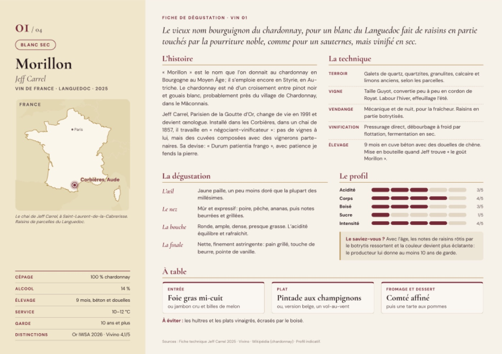

# Agent skills

**Skills that give your coding agent new jobs**: printing tasting sheets for a wine evening, or finding out why your disk is full and cleaning it safely.

They work with **Claude Code, Codex, GitHub Copilot, Pi, Cursor, Gemini CLI** and [75+ other agents](https://github.com/vercel-labs/skills/blob/main/docs/agents.md). Each skill is a short Markdown file you can read in a few minutes. Installing one runs no code from this repo.

---

## The skills

### wine-tasting-sheets: a printable booklet for your next tasting

Give your agent a list of wines. It researches each one (producer sheets, critics, the region) and gives you a PDF with one page per wine, ready to print and hand out.



- **Everything on one page:** the story behind the wine, how it's made, tasting notes, a 1–5 profile, a "did you know?", three food pairings, and a map with a dot on the vineyard.
- **Any language:** French, English, Dutch, Spanish, German and Italian are built in. Ask for another language and the agent adds it.
- **Two versions:** a colour version tinted to each wine, and an ink-saving one for the office printer.

> *"Make tasting sheets for these four wines, in English, printable version."*

[More about wine-tasting-sheets →](wine/)

### disk-doctor: "my disk is full", fixed without the fear

On macOS or Linux, it works out what is actually using your space. It lists what's safe to delete, and nothing is deleted until you've picked from that list.

```
diagnose → audit (read-only) → YOU CHOOSE → clean only your selection → before/after report
```

- **Finds what other tools miss:** files left behind by apps you uninstalled, and old versions that tools keep piling up (one folder per IDE release, in three places at once). It also names what the bytes actually are, e.g. "4 GB of Chrome is an on-device AI model".
- **Sorts every finding by risk:** dead weight, stale archives, rebuildable caches, and *keep*. Your documents, profiles and keys are never even offered for deletion.
- **Cleans the careful way:** it uses each tool's own cleaner first (`brew cleanup`, `npm cache clean`, `docker system prune`…). It checks that apps are closed before touching their files, and it stops if anything doesn't match the report.

> *"My disk is full, what's taking all the space?"*

[More about disk-doctor →](disk/)

---

## Install

Each skill can be installed on its own (`disk`, `wine`). Use **one** method per agent; installing both ways gives you every skill twice.

**Claude Code**: updates itself.
```
/plugin marketplace add brkaisin/skills
/plugin install wine@brkaisin
/plugin install disk@brkaisin
```

**Codex**: updates at startup.
```bash
codex plugin marketplace add brkaisin/skills
codex plugin add wine@brkaisin
```

**GitHub Copilot CLI**
```bash
copilot plugin marketplace add brkaisin/skills
copilot plugin install wine@brkaisin
```

**Pi, Cursor, Gemini CLI, OpenCode, and any other agent with skill support**
```bash
npx skills add brkaisin/skills            # pick the skills and agents interactively
npx skills update                         # later, to get new versions
```

Then restart your agent and ask for what you need, as in the examples above. In Claude Code you can also pick a skill from the `/` menu.

<details>
<summary><strong>Your agent doesn't support skills?</strong></summary>

Run `npx skills use brkaisin/skills@disk-doctor` to print the skill as a prompt you can paste into any chat. You can also clone this repo and add this line to your `AGENTS.md` or rules file: *"Skills live in `./skills/`. When a task matches a skill's description (see its `SKILL.md` frontmatter), read that file and follow it."* Skills that use helper scripts need shell access. Without it, the agent can follow the steps by hand.

</details>

## Why you can trust them

- **Nothing runs when you install.** Your agent's plugin system or `npx skills` only copies files, and you can read every one first.
- **Read-only until you decide.** A skill that can delete or change things analyses first and waits for your explicit choice. If it runs on a schedule, it never deletes anything.
- **Small and readable.** Each `SKILL.md` stays under about 150 lines of plain instructions. Longer details live in reference files the agent only opens when it needs them.
- **Few requirements.** The helper scripts use standard tools: plain bash, and Python's standard library. The wine skill also needs a browser (Chrome, Edge…) to make the PDF.

## Contributing

Ideas and fixes are welcome. [CONTRIBUTING.md](CONTRIBUTING.md) explains the layout, how to work on the skills locally, and how to add a new one.
